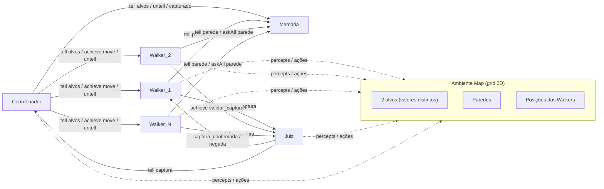
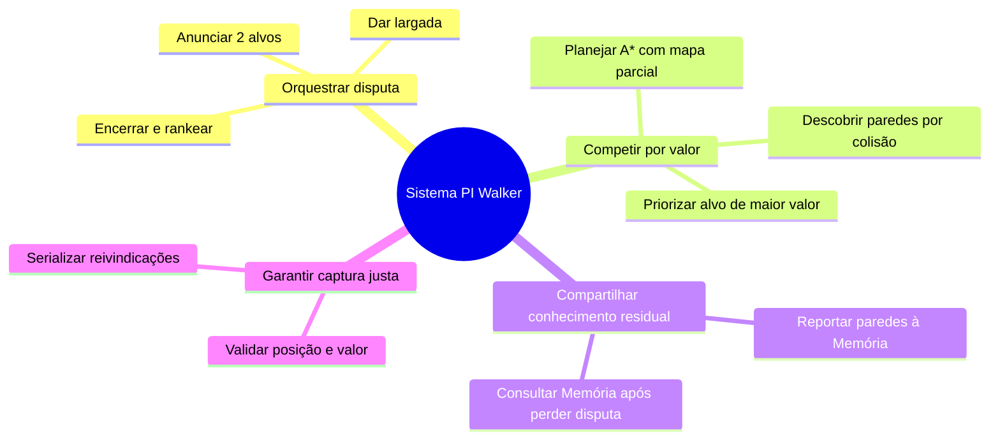
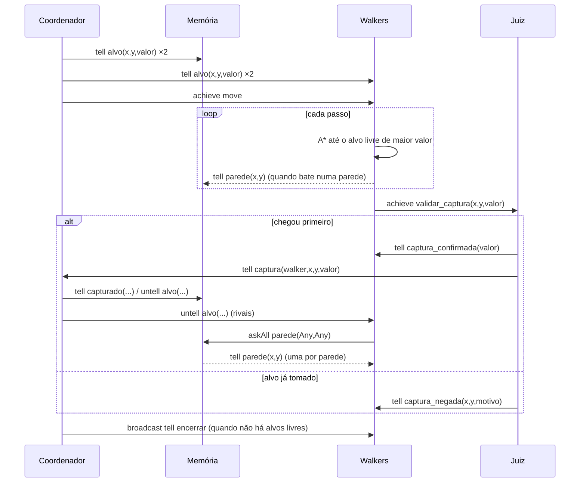
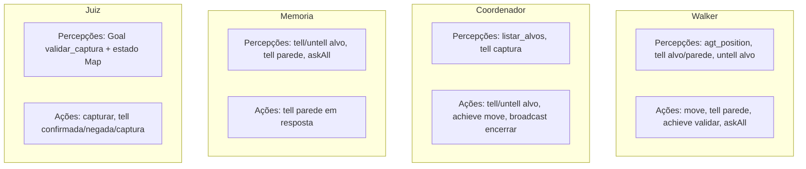

# MOD — Modelagem Prometheus
## Projeto Inicial — Sistemas Multiagentes (PPGCA/UTFPR)
### Tema: Walkers competindo por alvos de valores diferentes (MASPy)

Este documento apresenta a modelagem no estilo **Prometheus** (visão de agentes, percepções, ações, protocolos e objetivos), alinhada ao protótipo `pi-walker/`. Os diagramas Mermaid podem ser colados no Draw.io / Miro / Mermaid Live.

---

## 1. Visão geral do sistema



---

## 2. Agentes (especificações Prometheus)

### 2.1 Coordenador

| Campo | Conteúdo |
|---|---|
| **Papel** | Orquestrador da disputa |
| **Objetivos** | Anunciar alvos; dar largada; atualizar placar; remover alvos capturados; encerrar quando não houver alvos livres |
| **Percepções** | Resultado de `listar_alvos()`; mensagem `captura(walker,x,y,valor)` |
| **Ações** | `tell` alvos → Memória e Walkers; `achieve move` → Walkers; `untell alvo` → Memória e rivais; `broadcast encerrar` |
| **Dados** | Lista `capturas`; lista de Walkers |

### 2.2 Memória

| Campo | Conteúdo |
|---|---|
| **Papel** | Blackboard / registro coletivo |
| **Objetivos** | Registrar alvos, capturas e paredes; responder `askAll parede` |
| **Percepções** | Apenas mensagens |
| **Ações** | `tell parede(x,y)` em resposta a `askAll` |
| **Dados** | Crenças `alvo`, `capturado`, `parede` (imutáveis; uma crença por parede) |

### 2.3 Walker (N instâncias — competidores)

| Campo | Conteúdo |
|---|---|
| **Papel** | Agente navegador competitivo |
| **Objetivos** | Capturar o alvo livre de **maior valor**; se empate de valor, o mais próximo (Manhattan) |
| **Percepções** | `agt_position` (própria); `alvo` via `tell`; paredes via colisão e via Memória |
| **Ações** | `move(direção)`; `tell parede` → Memória; `achieve validar_captura` → Juiz; `askAll parede` → Memória |
| **Planos** | `conhecer_alvo`, `mover` (A*), `venci`, `perdi`, `alvo_perdido` (`lose`), `receber_parede`, `encerrar` |

### 2.4 Juiz

| Campo | Conteúdo |
|---|---|
| **Papel** | Arbitragem de captura (exclusão mútua) |
| **Objetivos** | Validar se o Walker está na célula do alvo livre com o valor correto |
| **Percepções** | Estado do percept `alvo` e `agt_position` no ambiente |
| **Ações** | `capturar()`; `tell captura_confirmada` / `captura_negada`; `tell captura` → Coordenador |

---

## 3. Objetivos do sistema (árvore)



---

## 4. Protocolo de interação (cenário principal)



### Performativas utilizadas

| Performativa | Uso |
|---|---|
| `tell` | Anunciar alvos, paredes, confirmação/negação, placar |
| `untell` | Remover alvo capturado das crenças dos rivais (dispara plano `lose`) |
| `achieve` | Largada (`move`) e validação (`validar_captura`) |
| `askAll` | Perdedor pede todas as paredes conhecidas à Memória |
| `broadcast` | Fim da disputa (`encerrar`) |

---

## 5. Diagrama de agentes × percepções × ações



---

## 6. Cenários Prometheus (resumo)

1. **Inicialização**: Coordenador lê alvos livres, anuncia a Memória e aos Walkers, dispara `move`.
2. **Corrida pelo maior valor**: Todos os Walkers priorizam o alvo de valor 50 (padrão); A* com custo 1,25 em células desconhecidas.
3. **Descoberta de parede**: Colisão → Walker atualiza `Wall_Set` e `tell` à Memória.
4. **Captura válida**: Walker na célula → Juiz confirma → Coordenador atualiza placar e `untell` o alvo.
5. **Captura negada / alvo perdido**: Walker remove o alvo, consulta Memória e replaneja para o próximo alvo livre.
6. **Encerramento**: Sem alvos livres → ranking → `broadcast encerrar` → agentes param o ciclo.

---

## 7. Decisões de desenho (ligação PRO ↔ MOD)

| Decisão | Motivo |
|---|---|
| Sem Q-learning neste PI | Política de um único alvo fica obsoleta quando o alvo some; competição = corrida com A* |
| Mapa compartilhado só via Memória | Walkers são rivais; só quem perde recebe o mapa coletivo |
| Juiz separado | Serializa capturas e evita dois donos para o mesmo alvo |
| Comunicação assíncrona | Evita deadlock de `ask*Reply` no ciclo MASPy |
| Contornos em `Base_Ag.Membro` | Bug de `untell` com lock não reentrante no maspy-ml 2026.5.13 |

---

## 8. Como usar no Draw.io / Miro

1. Copie cada bloco ` ```mermaid ` … ` ``` ` para [mermaid.live](https://mermaid.live) e exporte SVG/PNG.
2. Ou use o plugin Mermaid do Draw.io (`Arrange → Insert → Advanced → Mermaid`).
3. Os quadros das seções 2.x viram cartões de “Agent Descriptor” no Miro.

---

## 9. Rastreabilidade

| Artefato Prometheus | Onde está no código |
|---|---|
| System overview | Este doc + `README.md` de `pi-walker/` |
| Agent descriptors | `Equipe_Ag.py`, `Walker_Ag.py` |
| Interaction protocol | Sequência acima (= README do protótipo) |
| Environment model | `Map_Env.py` |
