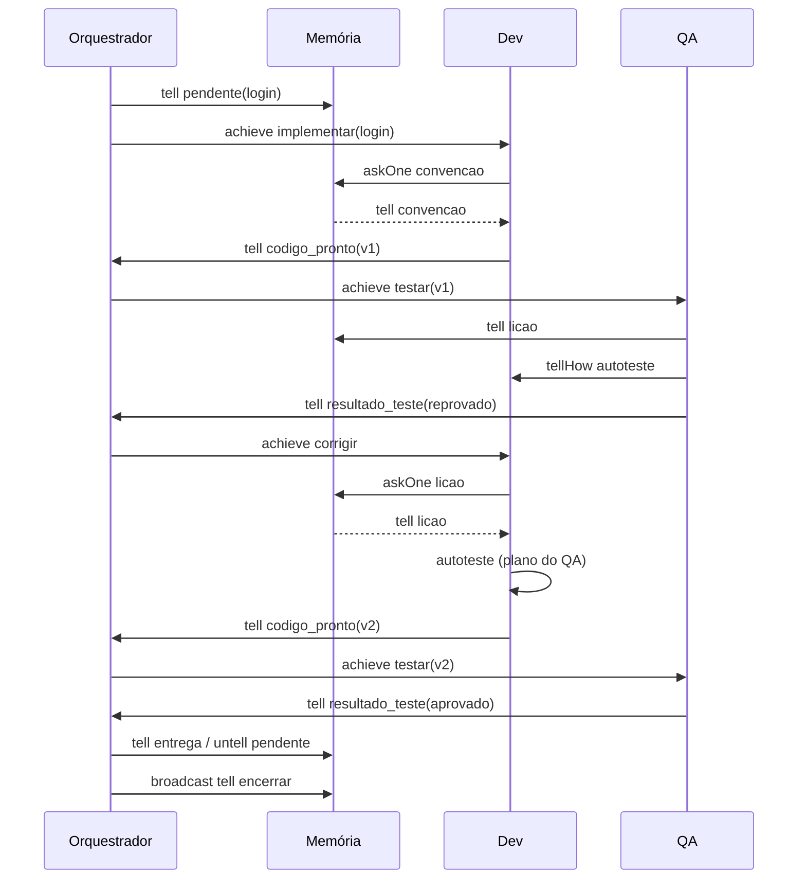

# Equipe de software com MASPY — Orquestrador, Memória, Dev e QA

Exemplo da aula 7 (comunicação entre agentes): quatro agentes MASPY conversam usando as
performativas KQML do `self.send(alvo, ato, conteúdo)` para entregar a feature "login".

## Como rodar

```
cd %USERPROFILE%\mestrado\sma-maspy
.venv\Scripts\activate
cd equipe-software
python equipe_software.py
```

Use sempre o Python da venv. **Não** rode `pip install maspy`: esse pacote é outro projeto e
sobrescreve o MASPY (o certo é `maspy-ml`). Se acontecer:
`pip uninstall -y maspy && pip install --force-reinstall --no-deps maspy-ml==2026.5.13`.

## Comunicação assíncrona

Nenhum agente fica bloqueado esperando resposta: o exemplo não usa `askOneReply`, que trava o
agente por até 2 s. Toda resposta chega como evento (`gain` de Belief/Goal) e dispara um plano.
Por exemplo, o Dev pergunta a convenção com `askOne` e só implementa quando o `tell` com a
resposta dispara o plano `implementar_v1`.

| Performativa | Efeito no destinatário | Uso aqui |
|---|---|---|
| `tell` / `untell` | adiciona / remove uma Belief | código pronto, resultado de teste, lição, pendência |
| `achieve` | adiciona um Goal (pede que ele faça algo) | implementar, testar, corrigir |
| `askOne` | pergunta; a resposta volta depois como `tell` | Dev consulta convenção e lição na Memória |
| `tellHow` | envia um Plano | QA ensina ao Dev o plano `autoteste`, que passa a rodar **no Dev** |
| `broadcast` | `tell` para todos os agentes | encerrar |

`Channel().show_exec = True` imprime cada mensagem trocada.

## Fluxo



A v1 é reprovada (senha salva em texto puro). O QA grava a lição na Memória e ensina o Dev a se
autotestar. Na correção, o Dev busca a lição, implementa a v2 com hash e roda o autoteste antes
de reenviar.

## A classe base `Membro` e os bugs do MASPY (maspy-ml 2026.5.13)

1. **`tellHow` não funciona sozinho:** `add(Plan)` coloca o plano em `_plans`, mas não reconstrói
   `_plan_index`, então o plano recebido nunca dispara. `Membro.add` chama
   `_build_plan_index()` depois de adicionar um `Plan`.
2. **`untell`/`unachieve` travam o agente que recebe:** o ciclo segura `update_lock` enquanto lê
   as mensagens, e o `rm()` chama `get()` sem `no_lock` (`agent.py:874`). Como o
   `threading.Lock` não é reentrante, a thread espera por ela mesma. `Membro.rm` liga uma flag
   por thread que faz o `get` interno rodar sem lock.
3. **`@pl` na classe base é compartilhado:** o decorator faz `classe._plans += [plano]`, que
   estende a lista herdada. Com um plano em `Membro`, todos os agentes passavam a ter os planos
   de todos (a Memória chegou a executar o plano de implementação do Dev). Por isso `Membro` não
   tem `@pl` e o `encerrar` está repetido em cada classe.
4. **Resposta de `askOne`/`askAll` altera a crença de quem responde:** o `send` sobrescreve o
   `source` do objeto guardado. Aqui não atrapalha, porque a Memória nunca altera
   `convencao`/`licao` depois de responder (no `../pi-walker` isso exigiu mudar o desenho).

Os padrões de crença precisam ter a mesma aridade dos valores: `Goal("tri", (Any, Any, Any))`
casa com `("x", 1, "y")`, mas `Goal("tri", Any)` não. Valores em tupla chegam ao plano como **um**
argumento.
