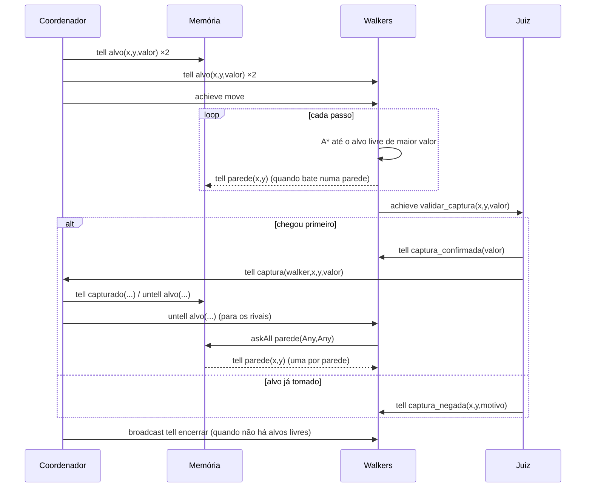

# PI — Walkers competindo por alvos de valores diferentes (MASPY)

Protótipo (parte **PRO**) do Projeto Inicial de SMA (PPGCA/UTFPR), construído a partir do exemplo
[`2D-Navigation-Learn`](https://github.com/laca-is/MASPY/wiki/Navigation-on-2D-Grid) do MASPY.

> Enunciado: Walker com **2 targets de valores diferentes**; os agentes **competem pelo de maior valor**.

## Como rodar

```
cd %USERPROFILE%\mestrado\sma-maspy
.venv\Scripts\activate
cd pi-walker
python Walker_Main.py            # menu Pygame + visualização do grid
python Walker_Main.py --sem-gui  # só terminal: mapa 10x10, 20% de paredes, 4 walkers, alvos 10 e 50
```

Use sempre o Python da venv. O pacote certo é **`maspy-ml`**. O `pip install maspy` instala
**outro** projeto, sem relação com este, que sobrescreve a pasta `maspy/` e quebra tudo. Se
isso acontecer:
`pip uninstall -y maspy && pip install --force-reinstall --no-deps maspy-ml==2026.5.13`.

No menu: largura, altura, % de paredes, nº de walkers e o valor de cada alvo.

## Agentes

A arquitetura é a mesma da conversa Orquestrador/Memória/Dev/QA (`../equipe-software`), com os
papéis adaptados ao grid:

| Agente | Papel | Percebe | Age |
|---|---|---|---|
| **Coordenador** (orquestrador) | Anuncia os alvos, dá a largada e, a cada captura, tira o alvo da disputa | `listar_alvos()` no ambiente | mensagens |
| **Memória** | Registro coletivo: alvos, placar e paredes descobertas por qualquer walker | só mensagens | responde `askAll` |
| **Walker** (N instâncias, competidores) | Corre até o alvo livre de **maior valor** (empate: o mais perto), com A* sobre o mapa que conhece | a própria posição (`agt_position`) | `move(direção)` |
| **Juiz** (QA) | Valida cada captura no ambiente: quem chega primeiro leva, e o segundo é negado | estado dos alvos | `capturar()` |

O walker não enxerga o mapa: ele descobre as paredes batendo nelas (A* com custo 1,25 para
células desconhecidas, igual ao exemplo base). Cada parede nova é contada à Memória. Quem perde
a disputa pede à Memória todas as paredes conhecidas antes de replanejar.

## Protocolo de interação

Toda a comunicação é **assíncrona**: ninguém usa `askOneReply`/`askAllReply`, que bloqueiam o
agente. Cada resposta chega como evento (`gain`/`lose` de crença) e dispara um plano.



| Performativa | Uso aqui |
|---|---|
| `tell` | anunciar alvos, relatar paredes, confirmar/negar captura, placar |
| `untell` | Coordenador manda todos esquecerem um alvo capturado → dispara o plano `lose` do walker, que replaneja |
| `achieve` | largada (`move`) e pedido de validação ao Juiz |
| `askAll` | perdedor pede à Memória todas as paredes conhecidas; ela responde com um `tell` por parede |
| `broadcast` | fim da disputa |
| listas de destinos/mensagens | `send([walkers], tell, [Belief, Belief])` anuncia os 2 alvos para todos de uma vez |

`Channel().show_exec = True` imprime cada mensagem no formato
`Coordenador_1 sending untell:Belief alvo((4, 5, 50)) to Walker_3`.

## Decisões em relação ao exemplo base

- **2 alvos com valor e dono**: o percept `alvo` agora é `(x, y, valor, dono)`. O alvo continua
  no mapa depois de capturado (fica verde na tela, com o nome do dono no placar).
- **Sem Q-learning**: o `2D-Navigation-Learn` treina uma política para um único alvo, que vira
  inútil assim que esse alvo é tomado. Aqui os alvos são anunciados e a competição é uma corrida
  com A* e mapa parcial, que é o que o exemplo base faz depois que alguém acha o alvo. Daria para
  voltar com o aprendizado usando o valor do alvo como recompensa.
- **Mapa compartilhado só via Memória**: no exemplo base os walkers se mandavam o grafo por
  broadcast. Como agora eles são rivais, só contam as paredes para a Memória, e ela só repassa
  a quem perdeu uma disputa.
- **Juiz separado**: o próprio ambiente decide se a captura vale (`capturar()` verifica posição,
  valor e se o alvo ainda está livre). O Juiz serializa as reivindicações, então dois walkers
  chegando juntos não levam o mesmo alvo.
- Coordenador e Juiz se conectam ao ambiente, mas usam `filter_perceptions(add, focus, <nome>)`
  para não receber todas as percepções como crenças. O `on_connect` só cria posição para walkers.

## Arquivos

| Arquivo | Conteúdo |
|---|---|
| `Walker_Main.py` | monta o sistema (menu Pygame ou `--sem-gui`) |
| `Map_Env.py` | ambiente: geração do mapa, 2 alvos, `move`, `listar_alvos`, `capturar` |
| `Walker_Ag.py` | walker competidor + A* do exemplo base |
| `Equipe_Ag.py` | Coordenador, Memória e Juiz |
| `Base_Ag.py` | classe `Membro`, com o contorno do bug do `untell` (abaixo) |
| `Pygame_Screens.py` | visualização do exemplo base + alvos com valor, placar e menu novo |

## Bugs do MASPY (maspy-ml 2026.5.13) que afetam este código

1. **`untell`/`unachieve` travam o agente que recebe.** O ciclo segura `update_lock` enquanto lê
   as mensagens. O `rm()` chama `self.get(typ)` sem `no_lock` (`agent.py:874`), e o `get` tenta o
   mesmo `threading.Lock`, que não é reentrante. Resultado: deadlock.
   **Contorno** (`Base_Ag.Membro`): quando o `rm` vem de uma mensagem (`no_lock=True`), uma flag
   por thread faz o `get` interno rodar sem lock.
2. **Resposta de `askOne`/`askAll` altera a crença de quem responde.** A resposta envia o próprio
   objeto guardado, e o `send` sobrescreve o `source` dele com o nome do remetente. Depois disso
   o `.change()`/`rm()` não acham mais a crença.
   **Contorno**: a Memória não guarda uma lista mutável (`mapa_paredes`); cada parede é uma crença
   `parede(x,y)` imutável, consultada com `askAll`.
3. **`@pl` numa classe base é compartilhado por todas as subclasses.** O decorator faz
   `classe._plans += [plano]`, que estende a lista herdada da base. Por isso `Membro` não tem
   planos e o `encerrar` está repetido em cada agente.
4. **`tellHow` não funciona sozinho** (não é usado aqui, mas aparece em `../equipe-software`):
   `add(Plan)` não reconstrói `_plan_index`, então o plano recebido nunca dispara. O contorno é
   chamar `self._build_plan_index()` depois de adicionar um `Plan`.

Os padrões de crença precisam ter a mesma aridade dos valores: `Belief("alvo", (Any, Any, Any))`
casa com `(4, 5, 50)`, mas `Belief("alvo", Any)` não casa. Valores em tupla chegam ao plano como
**um** argumento (`def plano(self, src, alvo)` → `alvo == (4, 5, 50)`).

## Próximos passos (PP / MOD)

- **PEAS**: medida de desempenho = valor capturado por walker (e passos até capturar); ambiente =
  grid parcialmente observável, dinâmico (rivais), discreto, multiagente competitivo; atuadores =
  `move`; sensores = posição própria + mensagens.
- **Prometheus**: os 4 papéis acima viram os agentes; o diagrama de sequência acima é o protocolo
  de interação; percepções = `agt_position`/alvos; ações = `move`/`capturar`.
